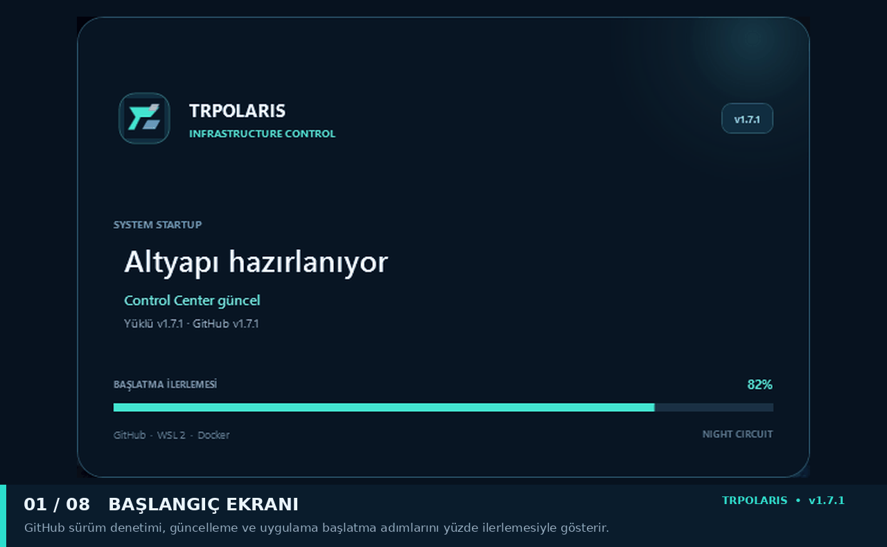

# 🏁 TRPOLARIS NFSU2 Web Control Center

### 🌌 Night Circuit · Windows Infrastructure Control

**NFSU2 Web sunucusunu Windows üzerinden kurun, güncelleyin, çalıştırın ve güvenle kaldırın.**

[⬇️ Son sürümü indir](https://github.com/trpolaris/TRPOLARIS-NFSU2-Web-Control-Center/releases/latest) · [🌐 NFSU2-Web kaynak projesi](https://github.com/trpolaris/NFSU2-Web) · [🛠️ GitHub Actions](https://github.com/trpolaris/TRPOLARIS-NFSU2-Web-Control-Center/actions) · [🐞 Hata bildir](https://github.com/trpolaris/TRPOLARIS-NFSU2-Web-Control-Center/issues)

---

## 📖 Proje hakkında

**TRPOLARIS NFSU2 Web Control Center**, NFSU2 Web sunucusunu Windows bilgisayarda kurmak ve çalıştığı altyapıyı güncel tutmak için geliştirilmiş bir **Windows masaüstü uygulamasıdır**.

Uygulama; Windows tarafındaki işlemleri tek bir arayüzde toplar, Linux tabanlı hazırlık ve derleme görevlerini **WSL 2 / Ubuntu** üzerinde yürütür, sunucuyu ise **Docker Desktop** ile çalıştırır. Böylece WSL, proje araçları, web kaynakları, Rust sunucusu ve WASM modülünü ayrı ayrı elle hazırlamak yerine kurulum ve güncelleme akışını Control Center üzerinden yönetebilirsiniz.

> **Kapsamı:** Control Center web sitesini veya oyunu yönetmez. Oyuncu, sohbet, yarış ya da oyun içi yönetim konsolu değildir. Görevi NFSU2 Web sunucusunun Windows üzerindeki kurulumunu, altyapı bakımını, servis yaşam döngüsünü ve kaldırılmasını kolaylaştırmaktır. Web uygulaması ve sunucu kaynak kodu ayrı [trpolaris/NFSU2-Web](https://github.com/trpolaris/NFSU2-Web) deposunda geliştirilir.

## ✨ Öne çıkan özellikler

| | Özellik | Ne işe yarar? |
|---|---|---|
| 🚀 | **Tek tık kurulum** | WSL 2, Ubuntu, Docker entegrasyonu ve gerekli proje araçlarını hazırlar. |
| 🎮 | **Oyun arşivi hazırlığı** | ZIP arşivini indirir veya bilgisayardan içe aktarır; kurulum öncesinde doğrular. |
| 📊 | **İndirme takibi** | Yüzde, anlık MB/s ve tahmini kalan süreyi gösterir. |
| ⏯️ | **Duraklat / devam et** | İndirmeyi duraklatır, sürdürür veya iptal eder; kaynak destekliyorsa kaldığı yerden devam eder. |
| 🔄 | **Altyapı güncelleme** | GitHub main kaynaklarını ve WSL araç zincirini yeniler; React, Rust ve WASM bileşenlerini yeniden derler. |
| 🐳 | **Docker servis kontrolü** | NFSU2 servisini başlatır, durdurur ve yeniden başlatır; sağlık durumunu görüntüler. |
| 🛡️ | **Otomatik uygulama güncellemesi** | Açılışta GitHub Release kontrolü yapar; yeni EXE'yi indirir, SHA-256 ile doğrular ve yedekli biçimde uygular. |
| 🗂️ | **Dosya yöneticisi** | WSL içindeki proje dosyalarını görüntüler, düzenler ve aktarır. |
| 🌐 | **Erişim ve paylaşım** | Local, LAN/HTTPS ve geçici Public Tunnel profillerini yapılandırır. |
| 📋 | **Canlı işlem günlükleri** | Aşamaları, ilerlemeyi, komut çıktılarını ve hata kayıtlarını tek ekranda gösterir. |
| 🧹 | **Kontrollü kaldırma** | NFSU2 bileşenlerini seçerek kaldırır; kalıcı verileri ve diğer Docker projelerini varsayılan olarak korur. |

## 🖼️ Ekran görüntüleri

Aşağıdaki ekran turu, uygulamanın açılışından günlük ekranına kadar temel bölümlerini sırayla gösterir. Tekil görselleri büyütmek için ilgili ekran görüntüsüne tıklayın.

  

## ⚙️ Nasıl çalışır?

Control Center, Windows arayüzünden aşağıdaki zinciri yönetir:

**Windows / WPF → WSL 2 / Ubuntu → GitHub kaynakları ve proje araçları → React + Rust + WASM derlemesi → Docker Compose → NFSU2 Web sunucusu**

### 🔄 Altyapı güncelleme akışı

1. GitHub main dalındaki güncel kaynak kodu alınır.
2. Ubuntu paketleri ve proje araç zinciri kontrol edilir; gerekli bağımlılıklar güncellenir.
3. WASM modülü hazırlanır; React ve Rust bileşenleri kilitli bağımlılık dosyalarıyla derlenir.
4. Yeni Docker imajı oluşturulur ve NFSU2 servisi yeniden başlatılır.
5. Sağlık kontrolü yapılır. Yeni sürüm sağlıklı başlamazsa önceki imaj ve WASM çıktısına geri dönüş denenir.

### 🛡️ Veri güvenliği

- Güncelleme sırasında oyun klasörü ve kalıcı Docker volume verileri normal akışta silinmez.
- Docker volume'lerini silen bir Compose işlemi normal güncelleme adımının parçası değildir.
- Yalnızca Control Center tarafından kurulan/doğrulanan NFSU2 Compose servisi hedeflenir; diğer Docker projeleri hedeflenmez.
- Kaldırma ekranındaki Ubuntu WSL, Docker Desktop, oyun dosyaları ve kalıcı kayıtları silme seçenekleri varsayılan olarak kapalıdır.
- Public Tunnel geçici bir erişim adresidir; bağlantıyı bilen herkese açık olabilir ve kendi başına kullanıcı doğrulaması sağlamaz.

## 🧱 Teknoloji altyapısı

| Katman | Teknolojiler |
|---|---|
| Windows uygulaması | C#, .NET 10, WPF, XAML |
| Windows otomasyonu | PowerShell 5.1 |
| Linux ortamı | WSL 2, Ubuntu, Bash |
| Konteyner | Docker Desktop, Docker Compose |
| Web arayüzü | React, Node.js 24, npm |
| Sunucu | Rust, Cargo |
| Oyun modülü | WASI SDK, WebAssembly |
| Yardımcı araçlar | Git, Python |

## 💻 Sistem gereksinimleri

**Windows Control Center**
- 64-bit Windows 10/11.
- Uygulama kurulumu ve sistem bileşenleri için gerektiğinde yönetici izni.
- İndirmeler ve kaynak güncellemeleri için internet bağlantısı.

**NFSU2 Web sunucu altyapısı**
- WSL 2 ve donanım sanallaştırması desteği.
- Ubuntu WSL dağıtımı.
- Docker Desktop ve Ubuntu için WSL Integration.
- Oyun arşivi, kaynak kodu, WASM çıktıları ve Docker imajları için yeterli disk alanı.

> Yayımlanan uygulama self-contained tek EXE olarak hazırlanır; Control Center'ı açmak için ayrıca .NET Desktop Runtime yüklemek gerekmez. WSL, Ubuntu ve Docker ise sunucu altyapısının gereksinimleridir.

## 📥 Kurulum

1. [GitHub Releases](https://github.com/trpolaris/TRPOLARIS-NFSU2-Web-Control-Center/releases/latest) sayfasından TRPOLARIS.NFSU2.WebControlCenter.exe dosyasını indirin.
2. EXE'yi çalıştırın. Windows yönetici izni isterse onaylayın.
3. **Sunucu Kurulumu** ekranında oyun arşivini indirin veya mevcut ZIP dosyanızı içe aktarın.
4. Oyun klasörünü doğrulayın ve **Kurulumu başlat** seçeneğini kullanın.
5. İşlemleri **İşlem Günlükleri** ekranından takip edin.

## 🔔 Uygulama güncellemesi

Control Center açılışta GitHub Releases üzerinden yeni uygulama sürümünü kontrol eder. Güncelleme bulunduğunda EXE ve sürüm manifesti indirilir; dosya SHA-256 ile doğrulanır ve mevcut uygulama yedeklenerek değiştirilir. Güncelleme bulunmazsa veya kontrol tamamlanamazsa mevcut sürüm açılır.

Uygulamanın kendi güncellemesi ile NFSU2 Web sunucusunun **Altyapı güncelleme** işlemi birbirinden ayrıdır:
- **Uygulama güncellemesi:** Windows'taki Control Center EXE dosyasını yeniler.
- **Altyapı güncellemesi:** WSL içindeki web kaynaklarını, derleme araçlarını ve Docker sunucu imajını yeniler.

## 🆕 Sürüm notları

### v1.7.2 · Arayüz, indirme ve kullanım iyileştirmeleri
- 🎨 Güncelleme denetimi penceresi Night Circuit tasarımına taşındı; güncel sürüm bilgisi sadeleştirildi.
- 🟢 Buton yazıları için kontrast ve metin gölgesi iyileştirildi; bilgi ipuçları koyu ve okunaklı hale getirildi.
- 🖱️ Açılış Splash Screen penceresi fareyle taşınabilir.
- 📥 Oyun arşivi için **Oyunu indir** tarayıcı düğmesi eklendi ve MediaFire indirme adresi yenilendi.
- 🧹 Kullanılmayan alanlar ve derleme uyarısı oluşturan kod temizlendi.

### v1.7.1 · Arayüz ve açılış iyileştirmeleri
- 🎯 Üst çubuk ikonları ve daha kompakt durum eylemleri.
- 💡 Kurulum ekranında soru işaretli bilgi ipuçları ve sadeleştirilmiş yerleşim.
- 🧭 Dosya Yöneticisi ile Erişim ve Paylaşım ekranları korundu.
- ⏳ Taşmaları giderilmiş splash ekranı ve güncelleme kontrolü sırasında yüzde ilerlemesi.

### v1.7.0 · Night Circuit
- 🌌 Koyu grafit yüzeyler, neon vurgular ve yenilenmiş WPF bileşenleri.
- ✨ Yeni splash screen ve açılış deneyimi.
- 🔔 GitHub Release kontrolü ve SHA-256 doğrulamalı uygulama güncelleme akışı.

### v1.6.6 · İndirme ve WSL/Docker
- 📥 Oyun arşivi indirme, içe aktarma ve otomatik yerleştirme.
- 📊 İndirme yüzdesi, anlık hız ve tahmini kalan süre.
- ⏯️ Duraklatma, devam ettirme ve iptal; destekleyen kaynaklarda kaldığı yerden indirme.
- 🐧 Docker Desktop – Ubuntu WSL 2 entegrasyon kontrolü ve hazırlığı.

## 🛠️ Kaynak koddan derleme

    git clone https://github.com/trpolaris/TRPOLARIS-NFSU2-Web-Control-Center.git
    Set-Location TRPOLARIS-NFSU2-Web-Control-Center
    dotnet restore .\src\TRPOLARIS.NFSU2.WebControlCenter\TRPOLARIS.NFSU2.WebControlCenter.csproj -r win-x64
    dotnet publish .\src\TRPOLARIS.NFSU2.WebControlCenter\TRPOLARIS.NFSU2.WebControlCenter.csproj -c Release -r win-x64 --self-contained true

Kaynak koddan derlemek için Windows üzerinde .NET 10 SDK ve WPF geliştirme araçları gereklidir.

## 🔗 Bağlantılar

- [⬇️ Son sürümü indir](https://github.com/trpolaris/TRPOLARIS-NFSU2-Web-Control-Center/releases/latest)
- [🛠️ Release derleme akışı](https://github.com/trpolaris/TRPOLARIS-NFSU2-Web-Control-Center/actions/workflows/release-control-center.yml)
- [🌐 NFSU2-Web kaynak projesi](https://github.com/trpolaris/NFSU2-Web)
- [🐞 Hata bildir / öneri gönder](https://github.com/trpolaris/TRPOLARIS-NFSU2-Web-Control-Center/issues)

---

**TRPOLARIS** · NFSU2 Web Control Center · **v1.7.2**

*Install · Update · Maintain · Remove*

