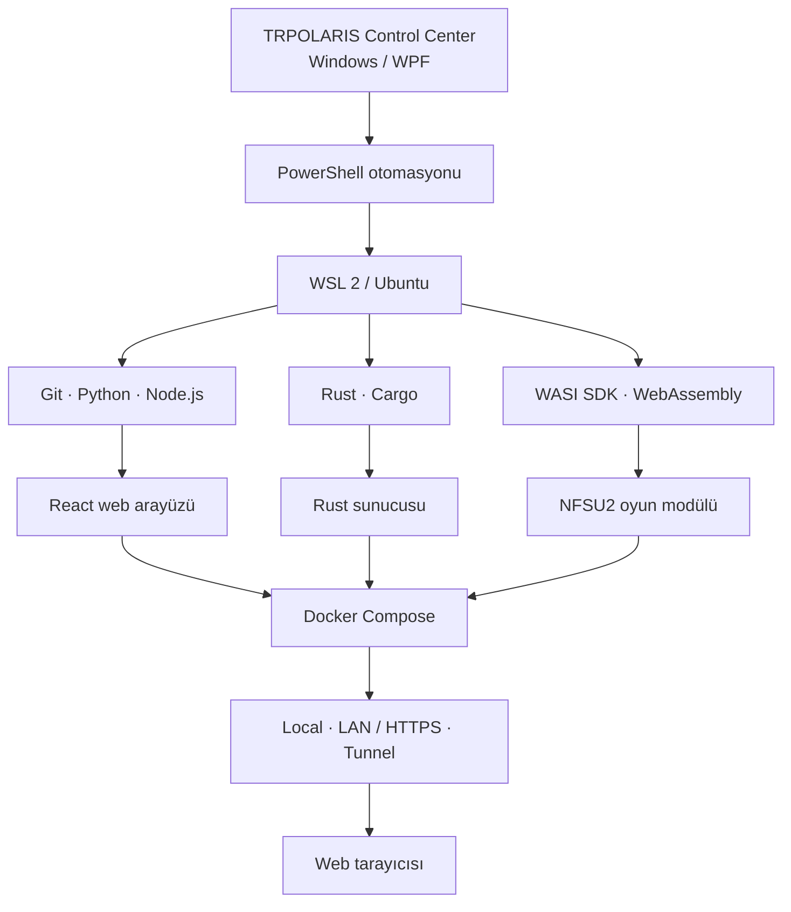

<div align="center">

# 🏁 TRPOLARIS NFSU2 Web Control Center

### NFSU2 Web sunucusunu Windows üzerinden kurmak, yapılandırmak ve yönetmek için yerel masaüstü kontrol merkezi

[](https://github.com/trpolaris/TRPOLARIS-NFSU2-Web-Control-Center/releases/latest)
[](https://github.com/trpolaris/TRPOLARIS-NFSU2-Web-Control-Center/actions/workflows/release-control-center.yml)
[](https://www.microsoft.com/windows)
[](https://dotnet.microsoft.com/)
[](https://learn.microsoft.com/dotnet/desktop/wpf/)

**[⬇️ Son sürümü indir](https://github.com/trpolaris/TRPOLARIS-NFSU2-Web-Control-Center/releases/latest)** · **[🌐 NFSU2 Web sunucu projesi](https://github.com/trpolaris/NFSU2-Web)** · **[🧰 GitHub Actions](https://github.com/trpolaris/TRPOLARIS-NFSU2-Web-Control-Center/actions)**

</div>

---

## Proje hakkında

**TRPOLARIS NFSU2 Web Control Center**, tarayıcı üzerinden oynanabilen NFSU2 Web sunucusunun Windows tarafındaki kurulum ve yönetim aracıdır. WSL 2, Ubuntu ve Docker Desktop altyapısını tek bir yerel WPF uygulaması üzerinden hazırlar ve yönetir.

Uygulama oyunun kendisi veya tarayıcı oyun istemcisi değildir. Web arayüzü ve sunucu kaynak kodu ayrı depoda tutulur: **[trpolaris/NFSU2-Web](https://github.com/trpolaris/NFSU2-Web)**.

| Bilgi | Değer |
|---|---|
| Uygulama | TRPOLARIS NFSU2 Web Control Center |
| Güncel sürüm | **1.6.6** |
| Platform | Windows x64 |
| Arayüz | C# · WPF · XAML |
| Hedef framework | .NET 10 · net10.0-windows |
| Yayın biçimi | Self-contained, tek EXE |
| Varsayılan çalışma dizini | C:\nfsu2 |
| Varsayılan HTTP portu | 9093 |
| Sunucu kaynak kodu | trpolaris/NFSU2-Web |

## Öne çıkan özellikler

### Kontrol paneli ve sunucu yönetimi

- WSL, Ubuntu, Docker Engine ve NFSU2 servislerinin durumunu tek ekranda görüntüleme.
- Sunucuyu başlatma, durdurma ve yeniden başlatma.
- Docker Compose servislerini ve sağlık durumunu izleme.
- Yerel sunucu adresini açma veya panoya kopyalama.
- Son sunucu günlüklerini ve tanılama çıktılarını görüntüleme.

### Tek Tık Kurulum

Kurulum akışı, gerekli Windows ve Linux bileşenlerini kontrol ederek NFSU2 Web sunucusunu hazırlamayı amaçlar:

1. Windows, WSL ve oyun dosyaları için ön kontroller.
2. Ubuntu WSL dağıtımının bulunması ve WSL 2 gereksiniminin denetlenmesi.
3. Ubuntu'nun varsayılan WSL dağıtımı olarak ayarlanması.
4. Docker Desktop WSL Integration ayarlarında Ubuntu'nun etkinleştirilmesi.
5. Gerekli ayar değiştiyse Docker Desktop'ın kapatılıp yeniden başlatılması ve ayarların uygulanması.
6. Ubuntu içinden Docker Linux Engine bağlantısının doğrulanması.
7. Git, Python, Node.js, Rust ve WASI araç zincirinin hazırlanması.
8. React web katmanı, Rust sunucusu ve WebAssembly oyun modülünün derlenmesi.
9. Docker servislerinin başlatılması ve sağlık kontrolü.

Docker Desktop ayarları değiştirilmeden önce mevcut ayar dosyası yedeklenir. WSL Integration doğrulanamazsa kurulum başarılı sayılmaz. Docker yeniden başlatılırken çalışan container'lar geçici olarak durabilir.

### Oyun dosyalarını indirme ve doğrulama

- Uygulamadaki tanımlı indirme kaynağından ZIP arşivi indirme.
- Aynı bağlantıyı varsayılan tarayıcıda açabilme.
- Bilgisayardaki ZIP arşivini içe aktarma veya mevcut oyun klasörünü seçme.
- İndirme sırasında anlık MB/s, aktarılan veri, yüzde ve tahmini kalan süreyi görüntüleme.
- İndirmeyi duraklatma, devam ettirme ve iptal etme.
- Bağlantı kesintilerinde otomatik yeniden deneme.
- Kısmi indirmeyi ve indirme metadata'sını yerel diskte koruma.
- Sunucu HTTP Range desteği veriyorsa kaldığı yerden devam etme; sunucu aralıklı indirmeyi desteklemiyorsa güvenli şekilde baştan başlama.
- ZIP açılmadan önce arşiv yollarını ve boyut sınırlarını denetleme.
- Doğrulama başarılı olmadan mevcut oyun klasörünü değiştirmeme.

**Oyun sürümü doğrulaması:** Mevcut WASM üretim akışı North America v1.2 oyun dosyalarını bekler. Bu nedenle **SPEED2.EXE** için dosya boyutu ve SHA-256 kontrolü yapılır; ayrıca **CARS**, **FRONTEND**, **GLOBAL** ve **TRACKS** klasörleri aranır. Farklı sürüm veya eksik arşiv otomatik olarak kabul edilmez.

### İki ayrı GitHub güncelleme sistemi

Uygulamada birbirinden bağımsız iki güncelleme akışı bulunur:

**Control Center uygulama güncellemesi**

- Üst çubuktaki **Güncellemeleri denetle** düğmesi GitHub'daki son kararlı Release'i kontrol eder.
- Yeni sürüm ve sürüm notları gösterilir.
- EXE ile **latest.json** manifesti indirilir.
- İndirilen EXE'nin SHA-256 değeri doğrulanır.
- Yardımcı updater çalışan uygulama kapandıktan sonra EXE'yi yedekli biçimde değiştirir ve uygulamayı yeniden açar.
- Güncelleme başarısız olursa önceki EXE'ye dönmeyi dener.

**NFSU2 Web sunucu güncellemesi**

- Sunucu Yönetimi ekranından NFSU2-Web deposunun **main** dalı kontrol edilir.
- Python/WASI araçları ve bağımlılıkları güncellenir.
- WASM modülü yeniden üretilir.
- React/npm ve Rust/Cargo bağımlılıklarıyla Docker imajları yeniden derlenir.
- Yeni servis sağlık kontrolünden geçerse uygulanır.
- Hata durumunda önceki Docker imajı ve WASM modülüne geri dönüş denenir.
- Oyun klasörü ve Docker **/state** kayıt hacmi korunur.

Sunucu güncellemesi için kullanılan depo: **[trpolaris/NFSU2-Web](https://github.com/trpolaris/NFSU2-Web)**.

### Dosya yöneticisi

- WSL içindeki NFSU2 proje dosyalarını ve klasörlerini gezme.
- Dosya yükleme, indirme, oluşturma, yeniden adlandırma ve silme.
- Dosyaları VS Code veya Not Defteri ile açma.
- Proje klasörünü Windows Explorer veya VS Code ile açma.
- İzlenen kaynak değişikliklerini algılama ve uygun olduğunda Docker imajını yeniden oluşturarak sunucuya uygulama.

### Erişim profilleri

| Profil | Kullanım | Adres örneği |
|---|---|---|
| **Local** | Aynı bilgisayardan erişim | http://localhost:9093/ |
| **LAN / HTTPS** | Aynı yerel ağdaki cihazlar | https://LAN-IP:PORT/ |
| **Public Tunnel** | Geçici internet paylaşımı | https://….trycloudflare.com |

LAN erişimi için yerel IP ve HTTPS portu yapılandırılabilir. Public Tunnel, Cloudflare Quick Tunnel ile geçici bir HTTPS adresi oluşturur.

> **Güvenlik uyarısı:** Public Tunnel bağlantısını bilen herkes sunucuya erişebilir. Bu profil yerleşik kullanıcı doğrulaması sağlamaz; kalıcı ve herkese açık kullanım için ayrıca erişim kontrolü, güvenlik duvarı ve ters proxy yapılandırılmalıdır.

### Tanılama, günlükler ve kaldırma

- WSL 2, Ubuntu, Docker Engine, port ve oyun dosyası kontrolleri.
- Sistem durumunu yeniden tarama ve WSL bağlantısını yeniden başlatma.
- Docker tanılama çıktısını toplama.
- PowerShell ve WSL çıktısını canlı işlem günlüğünde izleme.
- İşlem kategorisi, aşama, ilerleme ve hata kodlarını görüntüleme.
- Uzun işlemler için güvenli durdurma veya kullanıcı onaylı hemen iptal.
- Bileşen bazlı kaldırma.

Kayıt hacmi, oyun klasörü, Ubuntu WSL dağıtımı ve Docker Desktop gibi veri kaybına yol açabilecek kaldırma seçenekleri varsayılan olarak seçili değildir.

## Mimari



| Katman | Teknoloji |
|---|---|
| Windows masaüstü | C#, .NET 10, WPF, XAML |
| Windows otomasyonu | Windows PowerShell 5.1 |
| Linux ortamı | WSL 2, Ubuntu, Bash |
| Konteyner altyapısı | Docker Desktop, Docker Compose |
| Web istemcisi | React, Node.js, npm |
| Sunucu | Rust, Cargo |
| Oyun modülü | C / WASI SDK, WebAssembly |
| Yardımcı araçlar | Git, Python |

## Kurulum

### Hazır uygulamayı kullanma

1. [Son kararlı Release sayfasını](https://github.com/trpolaris/TRPOLARIS-NFSU2-Web-Control-Center/releases/latest) aç.
2. **TRPOLARIS.NFSU2.WebControlCenter.exe** dosyasını indir.
3. EXE'yi çalıştır ve Windows UAC yönetici iznini onayla.
4. **Tanılama ve Bakım** ekranında sistem kontrollerini çalıştır.
5. **Tek Tık Kurulum** ekranında oyun klasörünü seç veya ZIP arşivini içe aktar.
6. Oyun dosyalarını doğrula ve Local, LAN/HTTPS veya Public Tunnel erişim profilini seç.
7. Kurulumu başlat ve **Canlı İşlem Günlüğü** ekranından aşamaları takip et.

Yayınlanan EXE self-contained ve tek dosyalıdır; uygulamayı çalıştırmak için ayrıca .NET Desktop Runtime kurulması gerekmez. Sunucu altyapısı için WSL 2, Ubuntu ve Docker Desktop gereklidir.

### Sistem gereksinimleri

**Kontrol Merkezi**

- 64-bit Windows.
- Windows x64 üzerinde yönetici izni.
- İnternet bağlantısı.
- Uygulama için ayrı .NET Runtime kurulumu gerekmez; dağıtılan EXE self-contained'dır.

**NFSU2 Web sunucusu**

- WSL 2 ve donanım sanallaştırması desteği.
- Ubuntu WSL dağıtımı.
- Docker Desktop ve Ubuntu için WSL Integration.
- Oyun arşivi, WASM çıktıları, Docker imajları ve kaynak kodu için yeterli disk alanı.
- Araç zinciri ve bağımlılıkların indirilebilmesi için internet erişimi.

**Kaynak koddan derlemek için**

- .NET 10 SDK.
- WPF geliştirme desteği ve Windows x64 ortamı.
- Windows PowerShell 5.1 veya PowerShell 7.

## Kaynak koddan derleme

Depoyu klonla:

```powershell
git clone https://github.com/trpolaris/TRPOLARIS-NFSU2-Web-Control-Center.git
cd TRPOLARIS-NFSU2-Web-Control-Center
```

Uygulamayı derle ve tek EXE olarak yayımla:

```powershell
Set-ExecutionPolicy -Scope Process Bypass

dotnet restore .\src\TRPOLARIS.NFSU2.WebControlCenter\TRPOLARIS.NFSU2.WebControlCenter.csproj -r win-x64

dotnet build .\src\TRPOLARIS.NFSU2.WebControlCenter\TRPOLARIS.NFSU2.WebControlCenter.csproj -c Release -r win-x64 --no-restore

.\Publish-SingleFile.ps1
```

Alternatif olarak kök dizindeki **Repair-NuGet-RuntimePacks.ps1** betiği restore, Release build ve tek dosya publish işlemlerini sırayla çalıştırır.

Başarılı yayın çıktısı:

```text
publish\TRPOLARIS.NFSU2.WebControlCenter.exe
```

## Yeni Control Center sürümü yayımlama

GitHub Actions workflow'u, **v*** biçimindeki bir etiket gönderildiğinde Windows üzerinde uygulamayı derler ve Release oluşturur.

1. Proje dosyasındaki **Version** değerini yeni sürüme yükselt.
2. Değişiklikleri **main** dalına gönder.
3. Proje sürümüyle aynı isimde bir Git etiketi oluştur ve gönder.

Örnek sonraki sürüm akışı:

```powershell
git switch main
git pull --ff-only origin main

git tag -a v1.6.7 -m "TRPOLARIS Control Center v1.6.7"
git push origin v1.6.7
```

Workflow, Git etiketi ile proje sürümü eşleşmiyorsa yayını durdurur. Başarılı derlemede aşağıdaki iki dosya Release'e eklenir:

- **TRPOLARIS.NFSU2.WebControlCenter.exe**
- **latest.json** — sürüm, mimari, dosya adı ve SHA-256 manifesti.

[Release workflow](https://github.com/trpolaris/TRPOLARIS-NFSU2-Web-Control-Center/actions/workflows/release-control-center.yml) · [GitHub Actions sonuçları](https://github.com/trpolaris/TRPOLARIS-NFSU2-Web-Control-Center/actions)

## Dosya konumları ve veri koruma

| Konum | İçerik |
|---|---|
| **C:\nfsu2** | NFSU2 Web çalışma ve proje dizini |
| **C:\nfsu2\game** | Doğrulanmış yerel oyun dosyaları |
| **C:\nfsu2\NFSU2-SETUP-REPORT.txt** | Son kurulum raporu |
| **C:\nfsu2\NFSU2-UPDATE-REPORT.txt** | Son sunucu güncelleme raporu |
| **%LOCALAPPDATA%\TRPOLARIS\NFSU2-Web-Control-Center\logs** | Uygulama ve işlem günlükleri |
| **%LOCALAPPDATA%\TRPOLARIS\NFSU2-Web-Control-Center\runtime** | Geçici dosyalar ve devam ettirilebilir indirme parçaları |

### Güvenlik ve veri koruma ilkeleri

- ZIP arşivleri geçici alana açılır; yol taşması ve sembolik bağlantı girişimleri reddedilir.
- Oyun dosyaları doğrulanmadan mevcut oyun klasörü değiştirilmez.
- Yerleştirme öncesinde mevcut oyun klasörünün yedeği alınır; hata durumunda geri yükleme denenir.
- Control Center güncellemesinde EXE SHA-256 doğrulaması yapılır ve önceki EXE saklanır.
- Sunucu güncellemesinde oyun dosyaları ve Docker **/state** kayıt hacmi korunur.
- Normal güncelleme akışı genel Docker volume silme veya **docker compose down -v** kullanmaz.
- Kaldırma ekranında oyun dosyaları, kayıt hacmi, Ubuntu ve Docker Desktop seçenekleri varsayılan olarak kapalıdır.

## Sınırlamalar

- Masaüstü uygulaması Windows x64 ve WPF için geliştirilmiştir.
- Oyun doğrulaması mevcut WASM üretim hattının beklediği North America v1.2 dosya imzasıyla sınırlıdır.
- Oyun dosyaları GitHub kaynak deposuna dahil değildir.
- Kaldığı yerden indirme, indirme sunucusunun HTTP Range ve dosya doğrulayıcı desteğine bağlıdır. Sunucu Range desteği vermediğinde indirme baştan başlatılır.
- Public Tunnel geçicidir ve kendi başına kimlik doğrulaması sunmaz.
- Ubuntu'nun ilk çalıştırılmasında Linux kullanıcı adı ve parola oluşturulması istenebilir.

## Sorun giderme

| Belirti | Kontrol / çözüm |
|---|---|
| WSL dağıtımı bulunamıyor | **wsl --list --verbose** çıktısını ve Ubuntu kurulumunu kontrol et. |
| Docker Ubuntu içinden erişilemiyor | Docker Desktop'ın çalıştığını ve Settings → Resources → WSL Integration bölümünde Ubuntu'nun etkin olduğunu doğrula. |
| Docker ayarı uygulanmıyor | Docker Desktop'ı tamamen kapatıp yeniden aç; uygulamanın işlem günlüğündeki WSL Integration adımlarını incele. |
| Oyun arşivi reddediliyor | **SPEED2.EXE** dosya boyutu/hash kontrolünü ve gerekli oyun klasörlerini doğrula. |
| İndirme kaldığı yerden devam etmiyor | Kaynağın HTTP Range desteğini kontrol et; destek yoksa yeni indirme başlatılır. |
| Sunucu güncellemesi başarısız | Canlı işlem günlüğünü ve **C:\nfsu2\NFSU2-UPDATE-REPORT.txt** raporunu incele. |
| Control Center güncellemesi görünmüyor | [Releases](https://github.com/trpolaris/TRPOLARIS-NFSU2-Web-Control-Center/releases) sayfasında kararlı Release ve iki asset'in yayımlandığını doğrula. |

Hata bildirirken uygulama sürümünü, Windows sürümünü, **wsl --version** çıktısını, Docker Desktop sürümünü ve hassas bilgilerden arındırılmış ilgili günlükleri ekle.

## Proje yapısı

```text
TRPOLARIS-NFSU2-Web-Control-Center/
├── .github/
│   └── workflows/
│       └── release-control-center.yml
├── src/
│   └── TRPOLARIS.NFSU2.WebControlCenter/
│       ├── Assets/
│       ├── Properties/
│       ├── Resources/
│       │   ├── ControlCenterUpdater.ps1
│       │   ├── NFSU2-Windows-OneClick-Installer.ps1
│       │   ├── nfsu2-access.sh
│       │   ├── nfsu2-git-update.sh
│       │   └── nfsu2-project-lookup.sh
│       ├── App.xaml
│       ├── MainWindow.xaml
│       ├── MainWindow.xaml.cs
│       ├── app.manifest
│       └── TRPOLARIS.NFSU2.WebControlCenter.csproj
├── Publish-SingleFile.ps1
├── Repair-NuGet-RuntimePacks.ps1
├── TRPOLARIS.NFSU2.WebControlCenter.sln
└── README.md
```

## Lisans ve marka bilgisi

Depoda şu anda bir **LICENSE** dosyası bulunmuyor. Bu nedenle kaynak kodun kullanım, değiştirme ve yeniden dağıtım koşulları açık bir açık kaynak lisansıyla tanımlanmış değildir. Lisans eklenene kadar yeniden dağıtım veya türev çalışma yayımlamadan önce proje sahibinden izin alınmalıdır.

Need for Speed ve ilgili oyun markaları hak sahiplerine aittir. TRPOLARIS NFSU2 Web Control Center bağımsız bir topluluk aracıdır; oyun hak sahipleriyle resmî bağlantı veya onay iddiasında değildir.

---

<div align="center">

**TRPOLARIS** · NFSU2 Web Control Center · **v1.6.6**

*Kurulum, sunucu yönetimi ve uygulama güncellemeleri tek merkezde.*

</div>
